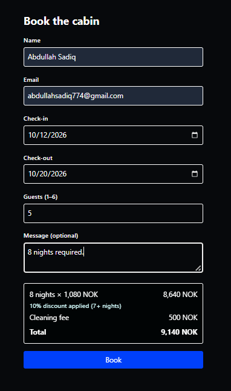
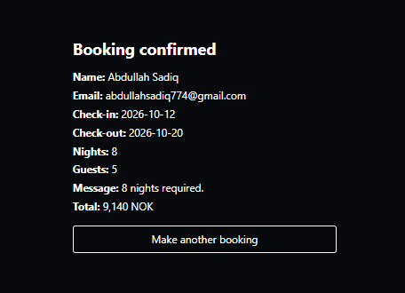

# Cabin Booking Form

A simple booking form for a holiday cabin, built with React and Tailwind CSS.

## Pricing

- 1,200 NOK per night
- 500 NOK cleaning fee
- Stays of 7 nights or more get 10% off the nightly price (the cleaning fee is not discounted)

| Stay     | Total     |
| -------- | --------- |
| 3 nights | 4,100 NOK |
| 7 nights | 8,060 NOK |

## Features

- Fields: name, email, check-in, check-out, guests (1-6) and an optional message
- Validation rules:
  - Check-in cannot be in the past
  - Check-out must be after check-in
  - Maximum stay is 14 nights
  - Guests must be between 1 and 6
- Errors appear under a field after the user leaves it
- Live price summary (nights x price, cleaning fee, total)
- Book button is disabled until the form is valid
- Confirmation screen with dates, nights, guests and total

## Screenshots





## Getting Started

```bash
npm install
npm run dev
```

Then open the local URL shown in the terminal.

## Project Structure

```
src/
  BookingForm.jsx   # The whole form: state, validation, price and confirmation
  App.jsx           # Renders <BookingForm />
```

## How It Works

- State is kept with `useState`: `values`, `touched` and `booked`.
- `errors`, `nights`, `price` and `isValid` are calculated on every render instead of being stored.
- `validate()` and `calculatePrice()` are plain functions outside the component.
- Redux was not used because the state is local to a single form.

## Tech Stack

- React
- Tailwind CSS
- Vite
