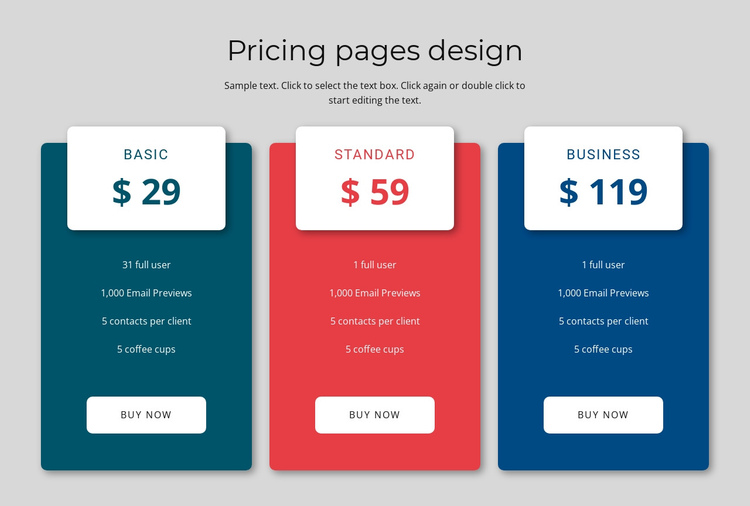
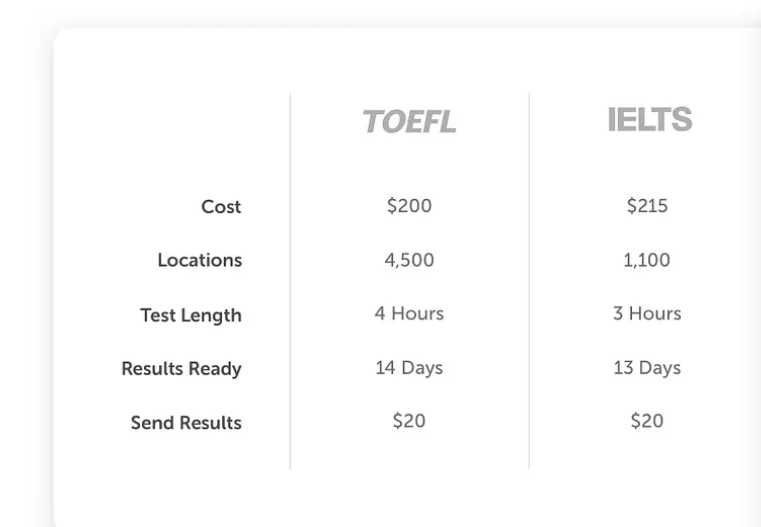
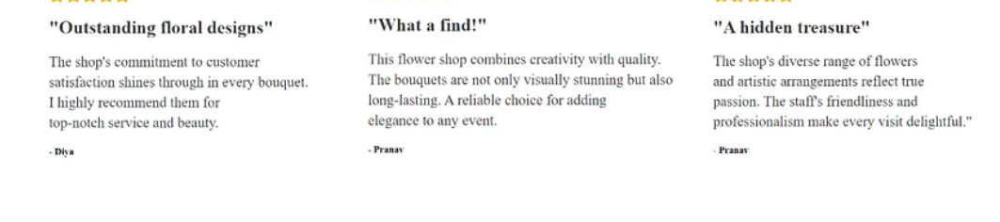

# Planora Pricing Page

A pricing page for a made-up product called **Planora**, built with React and Tailwind CSS.
The layout is based on reference designs I collected from the internet.
All layouts use flexbox only.

## Sections

1. Hero with navbar
2. Three pricing plans with a Monthly / Yearly switch
3. Plan comparison table
4. Customer testimonials
5. FAQ

## Structure plan

I planned the page as a tree of components at the start.

```
App
├── Hero
│   └── Navbar
├── Pricing            (holds the monthly/yearly state)
│   └── PlanCard x N   (made from `plans` in data.jsx)
├── ComparisonTable    (one column per plan, rows = comparisonLabels)
├── Testimonials       (made from `testimonials`)
└── Faq                (made from `faqs`, one answer open at a time)
```

### Folder structure

```
src
├── assets            (hero image and reference designs)
├── components
│   ├── ComparisonTable.jsx
│   ├── Faq.jsx
│   ├── Hero.jsx
│   ├── Navbar.jsx
│   ├── PlanCard.jsx
│   ├── Pricing.jsx
│   └── Testimonials.jsx
├── App.jsx
├── data.jsx          (ALL the content lives here)
├── index.css
└── main.jsx
```

## How it works

- **Switch:** `Pricing` keeps a `yearly` value in state (`false` = monthly).
  The Monthly and Yearly buttons change it, and every `PlanCard` reads it.
- **Price rule:** yearly price = monthly price x 10, so 2 months are free.
  Example: a plan that costs 100 NOK per month shows 1,000 NOK per year.
- **Comparison table:** every plan has a `details` list in the same order as
  `comparisonLabels`. The table loops over the labels once, then over each plan.
- **FAQ:** `openIndex` stores which question is open. Clicking another question
  opens it and closes the previous one.
- **Responsive:** the navbar links move to their own row on phones, and the hero
  text is centered vertically on desktop. Both use only flexbox and Tailwind's
  `md:` prefix.

## Changing the content (data change only)

Nothing outside `src/data.jsx` needs to change for these:

| I want to add        | What to do                                                                  |
| -------------------- | --------------------------------------------------------------------------- |
| A 4th plan           | Add one object to `plans` (with a `details` value for every label)          |
| Another testimonial  | Add one object to `testimonials`                                            |
| Another FAQ question | Add one object to `faqs`                                                    |
| A new table row      | Add one label to `comparisonLabels` and one value to every plan's `details` |

Plan colors are written as full Tailwind class names (for example `bg-teal-800`).
Tailwind can only find class names that are written out in full.

## Reference designs

These are the designs I collected and followed:

| Section          | Reference                                            |
| ---------------- | ---------------------------------------------------- |
| Hero             | Hero image: `src/assets/hero.avif`                   |
| Pricing plans    |      |
| Comparison table |       |
| Testimonials     |  |
| FAQ              |                  |

## Side-by-side comparison

Original reference designs (left) and my version (right):


## Image credit

Hero photo from Unsplash, free to use under the Unsplash License.

## Run it

```bash
npm install
npm run dev
```

## Built with

- React (Vite)
- Tailwind CSS
